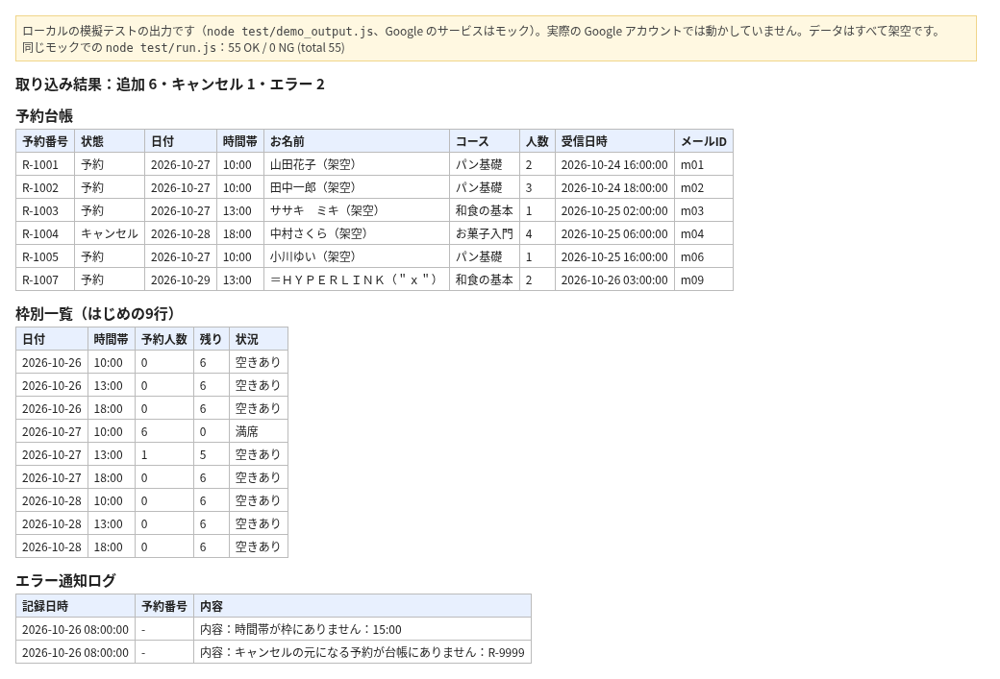

# 予約メールを台帳に写す手作業をなくす（GAS見本）

料理教室などで、予約サイトから届く通知メールを毎朝スプレッドシートに写している担当の方向けです。

架空の通知メール10通を読み、台帳に6件を追加し、キャンセル1件を反映し、読めない2通をエラー通知ログに残した結果です。上の画像は、ローカルの模擬テスト（`node test/demo_output.js`、Google のサービスはモック）の実際の出力から作りました。実際の Google アカウントでは動かしていません。

R-1007は、数式の形の名前を全角にして、数式として動かないようにした例です。

**効果：** 届いたメールを1通ずつ台帳に写す作業が、10分ごとの自動の書き込みになります。同じメールは二度入らず、キャンセルも台帳に反映されます。

架空の料理教室のデータで動きます。登場する教室・人物・メールはすべて架空です。

## 課題
予約サイトから届く通知メールを、毎朝1通ずつ台帳に写していました。
同じメールの二重入力や、キャンセルの反映漏れが起きやすく、枠の残りも数え直しが必要でした。

## 仕組み
1. 10分ごとに Gmail を検索し、件名が【予約受付】【キャンセル受付】のメールを読む
2. 本文から日時・枠・人数・予約番号を読み取り、「予約台帳」に1行追加
3. 読んだメールのIDを「取込済み」に記録し、同じメールは二度入れない
4. キャンセルは台帳の状態を「キャンセル」にして行を灰色にする
5. 「枠別一覧」に今日と、その先7日（計8日分）の人数・残り・状況を出す
6. 読めないメールは止めて、内容を「エラー通知ログ」に残す（送信はしない）

## 効果
| | 作る前 | 作った後 |
|---|---|---|
| 毎朝の転記 | 手で1通ずつ | 10分ごとに自動 |
| 二重入力・キャンセル漏れ | 起きやすい | 同じメールは二度入らない |
| 枠の残り | 数え直し | 枠別一覧ですぐ分かる |

ローカルの模擬テスト（`node test/run.js`、Google のサービスはモック）で55件すべて通ることを確かめています。

## 設置の手順
1. 新しいスプレッドシートを作り、「拡張機能」から Apps Script を開く
2. src/ の .gs ファイルを同じ名前で作って中身を貼り付け、appsscript.json も置き換える
3. Config.gs の検索条件と枠を自分の環境に合わせる
4. resetDemo を1回実行してシートを作る（初回は権限の許可が出ます）
5. setupTriggers を実行すると10分ごとに動く。止めるときは stopTriggers

## 止まるときと記録
- 読めないメール（枠にない時間、元の予約がないキャンセルなど）は台帳に入れず、「エラー通知ログ」に記録します
- 通知の送信関数は空のままです。このコードからメールは送られません

## ファイル
| ファイル | 役割 |
|---|---|
| src/Config.gs | シート名・検索条件・枠と定員 |
| src/MailParse.gs | メール本文の読み取り |
| src/Code.gs | 取り込み・トリガーの作成と停止・デモの初期化 |
| src/Dedupe.gs | 処理済みIDの記録 |
| src/Summary.gs・Notify.gs・Common.gs | 集計・通知文・共通の処理 |
| test/ | Node.js で動くテスト（demo_output.js は冒頭の画像の元になる出力） |

## 作りの工夫
- テスト：`node test/run.js`（Google のサービスを偽物に置き換えて Node.js で動かします。実際の Apps Script では動かしていません）
- 二重処理の防ぎ方：読んだメールのIDを「取込済み」シートに記録（src/Dedupe.gs の dedupeOpen_）。取り込みは src/Code.gs の importMails から importMailsLocked_ でロックを取って1つずつ動かす
- 6分制限：10分ごとの短い実行で、1回に読む数に上限を付けている（src/Code.gs の fetchMails_ の max）
- 権限は、このシート・Gmail の読み取り・トリガーの3つだけ（appsscript.json）

## 注意
- 架空のデータで動く見本です。実際の運用前に、自分の環境で動きを確かめてください
- Gmail・ドライブ・Apps Script には1日の上限があります

## 作った人
Reypage｜GAS業務自動化

## In English

A Google Apps Script sample that copies booking notification emails into a spreadsheet ledger. All data is fictional (a cooking school).
Every 10 minutes it searches Gmail for booking and cancellation emails, reads date, slot, party size and booking number, and adds a row to the ledger.
Read email IDs are recorded, so the same email is never added twice. Cancellations mark the row as cancelled, and a slot view shows today plus the next 7 days (8 days in total).
Emails it cannot read are kept out of the ledger and written to an error log sheet. The code sends no email.
How to try it:
1. Create a new spreadsheet and open Apps Script from Extensions.
2. Paste each `.gs` file in `src/` and replace `appsscript.json`. Adjust `Config.gs`.
3. Run `resetDemo` once to create the sheets, then `setupTriggers` to start (`stopTriggers` to stop).
4. Local tests with mocked Google services: `node test/run.js`. The image at the top is built from `node test/demo_output.js` on the same mocks. Not yet run in a real Apps Script project.

## ライセンス
MIT（LICENSE を参照）
