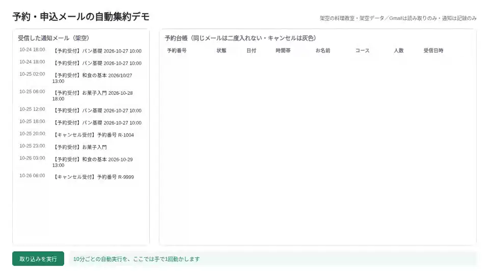
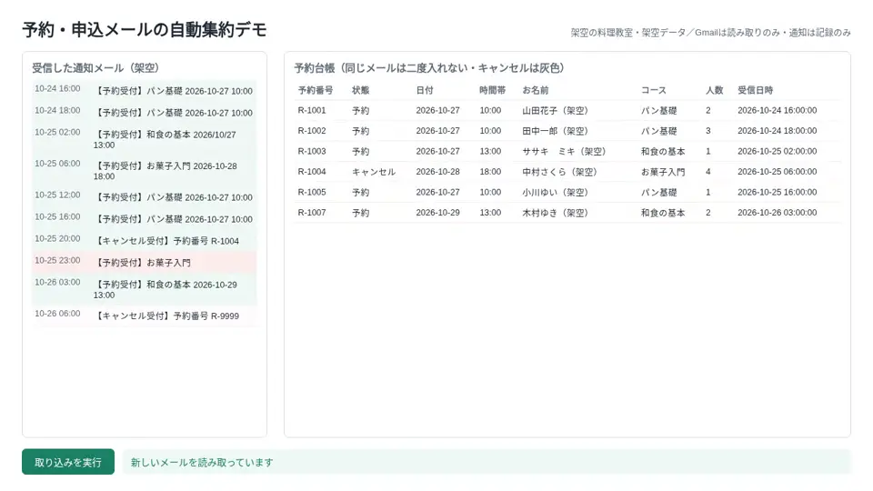
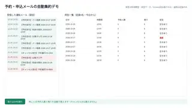

# gas-mail-to-sheet-ledger

通知メールをスプレッドシートの台帳に自動で書き込む Google Apps Script の見本です。
架空の料理教室のデータで動きます。登場する教室・人物・メールはすべて架空です。

## 課題
予約サイトから届く通知メールを、毎朝1通ずつ台帳に写していました。
同じメールの二重入力や、キャンセルの反映漏れが起きやすく、枠の残りも数え直しが必要でした。
（毎朝の転記は約30分。時間は説明用の例です）

## 仕組み
1. 10分ごとに Gmail を検索し、件名が【予約受付】【キャンセル受付】のメールを読む
2. 本文から日時・枠・人数・予約番号を読み取り、「予約台帳」に1行追加
3. 読んだメールのIDを「取込済み」に記録し、同じメールは二度入れない
4. キャンセルは台帳の状態を「キャンセル」にして行を灰色にする
5. 「枠別一覧」に今日から7日分の人数・残り・状況を出す
6. 読めないメールは止めて、内容を「エラー通知ログ」に残す（送信はしない）

## 効果（説明用の例）
| | 作る前 | 作った後 |
|---|---|---|
| 毎朝の転記 | 約30分 | 自動 |
| 二重入力・キャンセル漏れ | 起きやすい | 同じメールは二度入らない |
| 枠の残り | 数え直し | 枠別一覧ですぐ分かる |

## 画面

## 設置の手順
1. 新しいスプレッドシートを作り、「拡張機能」から Apps Script を開く
2. src/ の .gs ファイルを同じ名前で作って中身を貼り付け、appsscript.json も置き換える
3. Config.gs の検索条件と枠を自分の環境に合わせる
4. resetDemo を1回実行してシートを作る（初回は権限の許可が出ます）
5. setupTriggers を実行すると10分ごとに動く。止めるときは stopTriggers

## 止まるときと記録
- 読めないメール（枠にない時間、元の予約がないキャンセルなど）は台帳に入れず、「エラー通知ログ」に記録します
- 通知の送信関数は空のままです。このコードからメールは送られません

## ファイル
| ファイル | 役割 |
|---|---|
| src/Config.gs | シート名・検索条件・枠と定員 |
| src/MailParse.gs | メール本文の読み取り |
| src/Code.gs | 取り込み・トリガーの作成と停止・デモの初期化 |
| src/Dedupe.gs | 処理済みIDの記録 |
| src/Summary.gs・Notify.gs・Common.gs | 集計・通知文・共通の処理 |
| test/ | Node.js で動くテスト |

## 作りの工夫
- テスト：`node test/run.js`（Google のサービスを偽物に置き換えて Node.js で動かします。実際の Apps Script では動かしていません）
- 二重処理の防ぎ方：読んだメールのIDを「取込済み」シートに記録（src/Dedupe.gs の dedupeOpen_）。取り込みは src/Code.gs の importMails から importMailsLocked_ でロックを取って1つずつ動かす
- 6分制限：10分ごとの短い実行で、1回に読む数に上限を付けている（src/Code.gs の fetchMails_ の max）
- 権限は、このシート・Gmail の読み取り・トリガーの3つだけ（appsscript.json）

## 注意
- 架空のデータで動く見本です。実際の運用前に、自分の環境で動きを確かめてください
- Gmail・ドライブ・Apps Script には1日の上限があります

## 作った人
Reypage｜GAS業務自動化

## ライセンス
MIT（LICENSE を参照）
